# BÁO CÁO TOÀN DIỆN DỰ ÁN HỆ THỐNG THƯƠNG MẠI ĐIỆN TỬ HOA TƯƠI KFLOWER (KFLOWERVN)
> **Tài liệu Kỹ thuật, Kiến trúc Phần mềm & Báo cáo Dự án hoàn chỉnh**  
> **Dự án:** KFlower E-Commerce Platform (NodeJS-Core & Angular SPA)  
> **Tên miền hoạt động (Production):** `https://kflowervn.site`  
> **Cơ sở dữ liệu:** MySQL 8.0 (`flower_shop` / `nhkflopj_flower_shop`)  
> **Công nghệ nền tảng:** Node.js (>=20), Express.js, Sequelize ORM 6.x, Angular Frontend, Google Gemini AI (3.8-Flash), Multi-Payment Gateways (VietQR, MoMo, VNPay, COD), Nodemailer, Google OAuth 2.0.

---

## 📑 MỤC LỤC BÁO CÁO
1. [TÓM TẮT DỰ ÁN & CÁC CÔNG VIỆC ĐÃ HOÀN THÀNH](#-tóm-tắt-dự-án--các-công-việc-đã-hoàn-thành)
2. [CHƯƠNG 1: GIỚI THIỆU BÀI TOÁN & TỔNG QUAN HỆ THỐNG](#chương-1-giới-thiệu-bài-toán--tổng-quan-hệ-thống)
3. [CHƯƠNG 2: KIẾN TRÚC HỆ THỐNG & CÔNG NGHỆ ÁP DỤNG](#chương-2-kiến-trúc-hệ-thống--công-nghệ-áp-dụng)
4. [CHƯƠNG 3: CẤU TRÚC MÃ NGUỒN & THIẾT KẾ CƠ SỞ DỮ LIỆU](#chương-3-cấu-trúc-mã-nguồn--thiết-kế-cơ-sở-dữ-liệu)
   - 3.1. Cấu trúc thư mục dự án
   - 3.2. Mô hình quan hệ thực thể (ERD Diagram)
   - 3.3. Danh mục 31 Bảng dữ liệu & 26 Sequelize Models
   - 3.4. Danh mục 37 File Migrations (Tiến trình di trú dữ liệu)
   - 3.5. Danh mục 8 File Seeders (Khởi tạo dữ liệu mẫu thực tế)
5. [CHƯƠNG 4: THIẾT KẾ & HIỆN THỰC CÁC PHÂN HỆ NGHIỆP VỤ (MODULES)](#chương-4-thiết-kế--hiện-thực-các-phân-hệ-nghiệp-vụ-modules)
   - 4.1. Phân hệ Xác thực & Quản lý Người dùng (`auth`, `user`)
   - 4.2. Phân hệ Danh mục & Dịp lễ đa ngôn ngữ (`category`, `occasion`)
   - 4.3. Phân hệ Sản phẩm, Biến thể & Tìm kiếm gợi ý (`product`)
   - 4.4. Phân hệ Giỏ hàng phiên làm việc kép (`cart`)
   - 4.5. Phân hệ Mã giảm giá & Khuyến mãi (`coupon`)
   - 4.6. Phân hệ Đặt hàng & Vòng đời đơn hàng (`order`)
   - 4.7. Phân hệ Cổng thanh toán trực tuyến đa kênh (`payment`)
   - 4.8. Phân hệ Tư vấn hoa thông minh KFlower AI Chatbot (`ai-chat`)
   - 4.9. Phân hệ Đánh giá, Danh sách yêu thích & Thông báo (`review`, `wishlist`, `notification`)
   - 4.10. Phân hệ Báo cáo & Thống kê kinh doanh quản trị (`analytics`)
6. [CHƯƠNG 5: DANH MỤC API ENDPOINTS TOÀN DIỆN (RESTFUL API SPECIFICATION)](#chương-5-danh-mục-api-endpoints-toàn-diện-restful-api-specification)
7. [CHƯƠNG 6: TÍCH HỢP BÊN THỨ BA (THIRD-PARTY INTEGRATIONS)](#chương-6-tích-hợp-bên-thứ-ba-third-party-integrations)
8. [CHƯƠNG 7: AN TOÀN BẢO MẬT & VẬN HÀNH HỆ THỐNG (SECURITY & DEVOPS)](#chương-7-an-toàn-bảo-mật--vận-hành-hệ-thống-security--devops)
9. [CHƯƠNG 8: HƯỚNG DẪN CÀI ĐẶT, CẤU HÌNH & TÀI KHOẢN THỬ NGHIỆM](#chương-8-hướng-dẫn-cài-đặt-cấu-hình--tài-khoản-thử-nghiệm)
10. [CHƯƠNG 9: ĐÁNH GIÁ KẾT QUẢ ĐẠT ĐƯỢC & HƯỚNG PHÁT TRIỂN](#chương-9-đánh-giá-kết-quả-đạt-được--hướng-phát-triển)

---

## 📋 TÓM TẮT DỰ ÁN & CÁC CÔNG VIỆC ĐÃ HOÀN THÀNH

Hệ thống **KFlower (KFlowerVN)** là nền tảng thương mại điện tử chuyên biệt dành cho ngành hoa tươi và quà tặng nghệ thuật cao cấp tại Việt Nam (nguồn hoa Đà Lạt tươi mới mỗi ngày), hướng đến phục vụ cả khách hàng trong nước và cộng đồng người nước ngoài/kiều bào (đặc biệt là khách hàng Hàn Quốc).

### Bảng tổng hợp chỉ số phát triển dự án:
* **Kiến trúc phần mềm:** Monolithic kết hợp RESTful API Backend (`/api/*`), tài liệu Swagger UI OpenAPI 3.0 (`/api-docs`), và tích hợp Single Page Application (SPA) Angular trong thư mục `public/`.
* **Cơ sở dữ liệu:** 31 Bảng quan hệ chuẩn hóa 3NF, hỗ trợ UTF8MB4 Unicode đa ngôn ngữ.
* **Sequelize Models:** 26 Models độc lập được thiết lập đầy đủ quan hệ (Associations: 1-1, 1-N, N-N).
* **Database Migrations:** 37 file migration quản lý phiên bản cơ sở dữ liệu có tính chất Idempotent & Rollback an toàn.
* **Database Seeders:** 8 file seeder nạp đầy đủ dữ liệu mẫu sống động (ngôn ngữ, người dùng, danh mục, dịp lễ, sản phẩm, mã giảm giá, khung giờ giao, 5 đơn hàng thực tế).
* **Phân hệ chức năng (Modules):** 14 Modules nghiệp vụ hoàn chỉnh (Auth, User, Category, Occasion, Product, Cart, Coupon, Order, Payment, Review, Wishlist, Notification, AI-Chat, Analytics).
* **Tích hợp thanh toán:** 4 phương thức thanh toán toàn diện (VietQR Dynamic MBBank, MoMo Gateway Sandbox, VNPay Gateway Sandbox, SePay/Casso Bank Webhook, COD).
* **Trí tuệ nhân tạo (AI):** Trợ lý tư vấn chọn hoa KFlower AI sử dụng mô hình Google Gemini AI (`gemini-3.8-flash`) với kỹ thuật Dynamic Context Injection nạp danh mục hoa trực tiếp từ database, kèm bộ luật Fallback Rule-based thông minh.
* **Hệ thống Email:** Tự động gửi email giao dịch qua Gmail SMTP với giao diện HTML thương hiệu sang trọng (xác nhận đơn hàng, cảnh báo đơn mới cho admin, cấp lại mật khẩu, kích hoạt tài khoản).

---

## CHƯƠNG 1: GIỚI THIỆU BÀI TOÁN & TỔNG QUAN HỆ THỐNG

### 1.1. Bối cảnh và Bài toán thực tế
Kinh doanh hoa tươi trực tuyến là một phân khúc đặc thù trong ngành thương mại điện tử:
1. **Tính chất nhạy cảm về thời gian & độ tươi:** Hoa tươi có hạn sử dụng ngắn, yêu cầu giao siêu tốc (2–4 giờ nội thành) và cần khách hàng chọn chính xác khung giờ nhận hoa (Sáng, Chiều, Tối).
2. **Cá nhân hóa quà tặng:** Khách đặt hoa thường gửi gắm thông điệp (lời chúc mừng sinh nhật, khai trương, kỷ niệm, tỏ tình, chia buồn), do đó đơn hàng bắt buộc phải gắn liền với nội dung thiệp chúc mừng, banner thiết kế và thông tin người nhận riêng biệt với người thanh toán.
3. **Thị trường khách hàng đa quốc gia:** Nhu cầu đặt hoa từ cộng đồng kiều bào hoặc khách nước ngoài (đặc biệt là các doanh nhân, chuyên gia Hàn Quốc sinh sống và làm việc tại Việt Nam) gửi tặng người thân, đối tác là rất lớn. Hệ thống cần hỗ trợ giao diện và nội dung 3 ngôn ngữ (**Tiếng Việt**, **Tiếng Anh**, **Tiếng Hàn**) cùng các kênh liên lạc phổ biến như KakaoTalk ID.
4. **Trải nghiệm tư vấn hoa chuyên nghiệp:** Người mua hoa thường gặp khó khăn trong việc chọn loài hoa mang thông điệp phù hợp với từng dịp lễ hoặc mức ngân sách. Sự hỗ trợ từ AI Chatbot đóng vai trò như một chuyên gia cắm hoa tư vấn 24/7.

### 1.2. Các nhóm đối tượng người dùng & Quyền hạn (RBAC)
* **Khách vãng lai (Guest):**
  - Khám phá danh mục, dịp lễ, sản phẩm kèm giá khuyến mãi, hình ảnh và đánh giá.
  - Sử dụng thanh tìm kiếm thông minh có gợi ý tự động (Live Search Suggestion).
  - Tương tác với trợ lý KFlower AI Chatbot để nhận gợi ý hoa theo dịp và giá.
  - Thêm sản phẩm vào giỏ hàng ẩn danh thông qua định danh `x-session-id` mà không bắt buộc đăng nhập ngay.
  - Chuyển đổi ngôn ngữ hiển thị linh hoạt (`vi`, `en`, `ko`).
* **Khách hàng đã đăng ký (Customer):**
  - Đăng ký / Đăng nhập bằng Email & Mật khẩu hoặc đăng nhập nhanh 1 chạm qua Google OAuth 2.0.
  - Quên mật khẩu / Đặt lại mật khẩu và kích hoạt tài khoản qua Email xác thực bảo mật.
  - Quản lý hồ sơ cá nhân, cập nhật avatar, đồng bộ tài khoản KakaoTalk ID.
  - Quản lý sổ địa chỉ giao hàng nhận sẵn (thêm, sửa, xóa, đặt mặc định).
  - Tự động đồng bộ giỏ hàng vãng lai vào tài khoản sau khi đăng nhập.
  - Đặt hàng (Checkout) với đầy đủ thông tin: địa chỉ nhận, số điện thoại, khung giờ giao, lời chúc thiệp, người nhận khác người gửi.
  - Áp dụng mã giảm giá (Coupon), chọn hình thức thanh toán (VietQR, MoMo, VNPay, COD).
  - Theo dõi trạng thái đơn hàng thời gian thực; nhận email thông báo xác nhận đơn hàng tức thì.
  - Đánh giá sản phẩm đã mua (hệ thống chặn đánh giá ảo đối với khách chưa từng mua đơn hàng thành công).
  - Lưu trữ sản phẩm yêu thích (Wishlist) và nhận thông báo cá nhân.
* **Nhân viên cửa hàng (Staff):**
  - Quản lý danh mục hoa, cập nhật giá bán, số lượng tồn kho và trạng thái kích hoạt của sản phẩm.
  - Tra cứu, xem danh sách và chi tiết các đơn hàng đặt từ hệ thống.
  - Điều hướng và cập nhật vòng đời trạng thái đơn hàng (`pending` -> `confirmed` -> `processing` -> `ready_for_delivery` -> `out_for_delivery` -> `delivered`).
* **Quản trị viên hệ thống (Admin):**
  - Toàn quyền cấu hình hệ thống, quản lý tài khoản người dùng và phân quyền (`role`).
  - Quản lý danh mục, dịp lễ, bản dịch đa ngôn ngữ, sản phẩm, biến thể, hình ảnh và mã giảm giá.
  - Theo dõi trang Báo cáo Thống kê Quản trị (`/api/admin/stats`): doanh thu thời gian thực, biểu đồ doanh thu theo tháng, tỷ lệ đơn hàng, top sản phẩm sinh lời cao nhất, cơ cấu phương thức thanh toán và bản đồ phân bổ địa bàn khách hàng.

---

## CHƯƠNG 2: KIẾN TRÚC HỆ THỐNG & CÔNG NGHỆ ÁP DỤNG

### 2.1. Sơ đồ Kiến trúc Tổng thể (System Architecture)

```mermaid
flowchart TD
    subgraph Clients["Lớp Khách Hàng (Client Tier)"]
        WebUser["Khách Hàng / Quản Trị Viên (Web Browser)"]
        SPA["Angular SPA Frontend (public/)"]
        GoogleGSI["Google Identity Services"]
        WebUser --> SPA
        SPA -. Đăng nhập 1 chạm .-> GoogleGSI
    end

    subgraph Server["Lớp Máy Chủ Ứng Dụng (Node.js & Express.js)"]
        App["Express.js Core Engine (index.js / server.js)"]
        Security["Bảo Mật: Helmet, XSS-Clean, Rate-Limiter, CORS"]
        Logger["Winston & Morgan Daily Rotate Logger"]
        CronJob["Cron: Dọn đơn quá hạn 5 phút / lần"]
        Swagger["Swagger UI Docs (/api-docs)"]
        
        App --> Security
        App --> Logger
        App --> CronJob
        App --> Swagger

        subgraph Routes["Định Tuyến & Kiểm Soát (Routes & Kernels)"]
            APIRouter["API Router (/api)"]
            AuthMiddle["JWT Auth & Role Guard"]
            Validator["Express-Validator Kernel"]
            APIRouter --> AuthMiddle
            APIRouter --> Validator
        end
        Security --> APIRouter

        subgraph Modules["Các Phân Hệ Nghiệp Vụ (14 Modules)"]
            M_Auth["Auth & User"]
            M_Catalog["Category, Occasion, Product"]
            M_Cart["Cart & Coupon"]
            M_Order["Order & Shipment"]
            M_Pay["Payment Engine"]
            M_AI["KFlower AI Chatbot"]
            M_Review["Review, Wishlist, Notification"]
            M_Stats["Admin Analytics"]
        end
        APIRouter --> Modules
    end

    subgraph External["Dịch Vụ Bên Thứ Ba (Third-Party Services)"]
        GeminiAI["Google Gemini 3.8-Flash API"]
        MoMoGW["Cổng Thanh Toán MoMo"]
        VNPayGW["Cổng Thanh Toán VNPay"]
        VietQR["Dịch Vụ Sinh Mã VietQR"]
        SePayHook["SePay / Casso Webhook"]
        GmailSMTP["Google Gmail SMTP Server"]
        GoogleOAuthAPI["Google OAuth Tokeninfo API"]
    end

    subgraph DataTier["Lớp Dữ Liệu (Database Tier)"]
        SequelizeORM["Sequelize ORM (26 Models)"]
        MySQLDB[("MySQL 8.0 Database (31 Tables)")]
        SequelizeORM --> MySQLDB
    end

    SPA -- RESTful JSON Requests --> APIRouter
    Modules --> SequelizeORM
    M_AI --> GeminiAI
    M_Pay --> MoMoGW
    M_Pay --> VNPayGW
    M_Pay --> VietQR
    SePayHook -. IPN Call .-> M_Pay
    M_Auth -. Gửi mail xác thực .-> GmailSMTP
    M_Order -. Gửi hóa đơn .-> GmailSMTP
    M_Auth -. Xác minh ID Token .-> GoogleOAuthAPI
```



### 2.2. Chi tiết Công nghệ Nền tảng (Tech Stack)

| Hạng mục | Công nghệ sử dụng | Phiên bản | Vai trò & Mục đích sử dụng |
|---|---|---|---|
| **Môi trường chạy** | Node.js | >= 20.x | Nền tảng thực thi JavaScript phía máy chủ hiệu năng cao. |
| **Web Framework** | Express.js | ^4.19.2 | Bộ khung định tuyến RESTful API, quản lý middleware linh hoạt. |
| **Cơ sở dữ liệu** | MySQL Server | 8.0 | Hệ quản trị cơ sở dữ liệu quan hệ, hỗ trợ transaction và JSON type. |
| **ORM / Migration** | Sequelize & Sequelize CLI | ^6.37.3 | Ánh xạ đối tượng quan hệ, quản lý 37 migrations và 8 seeders dữ liệu. |
| **Giao diện Client** | Angular SPA | 17/18+ | Ứng dụng Single Page Application được biên dịch tối ưu vào thư mục `public/`. |
| **Trí tuệ nhân tạo** | Google Gemini API | `gemini-3.8-flash` | Xử lý ngôn ngữ tự nhiên, tư vấn chọn hoa theo ngữ cảnh cửa hàng. |
| **Cổng thanh toán** | MoMo & VNPay SDKs | v2 / v2.1.0 | Xử lý thanh toán thẻ ngân hàng, ví điện tử với chữ ký HMAC bảo mật. |
| **Chuyển khoản QR** | VietQR API | VietQR 2.0 | Tự động tạo mã QR chuyển khoản MBBank gắn sẵn mã đơn hàng và số tiền. |
| **Dịch vụ Email** | Nodemailer | ^10.3.1 | Giao thức SMTP gửi email giao dịch với template HTML thiết kế responsive. |
| **Bảo mật & Mã hóa** | BcryptJS, JWT, Helmet, XSS | v2.4 / v9.0 | Băm mật khẩu salt 10, cấp phát token JWT, ngăn chặn XSS và header attack. |
| **Kiểm soát lưu lượng** | Express-Rate-Limit | ^8.7.1 | Chống tấn công brute force và giới hạn tần suất gọi API live search. |
| **Ghi nhận nhật ký** | Winston & Morgan | ^3.19.0 | Ghi log hệ thống xoay vòng theo ngày (`combined-*.log`, `error-*.log`). |
| **Tài liệu API** | Swagger UI & OpenAPI 3.0 | ^5.0.0 | Tài liệu hóa trực quan các điểm cuối API tại địa chỉ `/api-docs`. |

---

## CHƯƠNG 3: CẤU TRÚC MÃ NGUỒN & THIẾT KẾ CƠ SỞ DỮ LIỆU

### 3.1. Cấu trúc thư mục dự án

```
NodeJS-Core-main/
├── configs/                     # Cấu hình môi trường và tham số hệ thống
│   ├── app.js                   # Cấu hình chung cho ứng dụng
│   ├── database.js              # Cấu hình kết nối MySQL (dev, test, prod)
│   ├── hashing.js               # Cấu hình thuật toán mã hóa mật khẩu
│   └── jwt.js                   # Cấu hình JWT secret và thời gian sống (TTL)
├── database/                    # Quản lý cơ sở dữ liệu theo mã nguồn
│   ├── migrations/              # 37 file di trú cấu trúc bảng & chỉ mục
│   └── seeders/                 # 8 file nạp dữ liệu mẫu ban đầu
├── kernels/                     # Thành phần lõi của ứng dụng
│   ├── api-docs/                # Tích hợp Swagger UI & nạp swagger yaml
│   ├── bootstrap.js             # Đăng ký alias đường dẫn gốc (rootpath)
│   ├── middlewares/             # authenticated.js, role.js, optionalAuth.js
│   ├── rules/                   # Các quy tắc kiểm tra kiểu dữ liệu (base.js)
│   └── validations/             # Middleware xác thực dữ liệu đầu vào request
├── models/                      # 26 Sequelize Models đại diện các bảng DB
│   ├── index.js                 # Tự động nạp toàn bộ model và thiết lập quan hệ
│   ├── user.js, order.js...     # Chi tiết từng model thực thể
├── modules/                     # Kiến trúc Module hóa chứa Controller & Service
│   ├── ai-chat/                 # Tư vấn hoa thông minh Google Gemini AI
│   ├── analytics/               # Báo cáo thống kê doanh thu & KPI cho Admin
│   ├── auth/                    # Đăng ký, đăng nhập JWT, Google OAuth, Reset Pass
│   ├── cart/                    # Giỏ hàng Session & User
│   ├── category/                # Danh mục sản phẩm & bản dịch đa ngôn ngữ
│   ├── coupon/                  # Mã giảm giá (phần trăm / số tiền cố định)
│   ├── notification/            # Thông báo hệ thống gửi đến người dùng
│   ├── occasion/                # Dịp lễ tặng hoa & bản dịch đa ngôn ngữ
│   ├── order/                   # Đặt hàng, chi tiết đơn, lịch sử trạng thái
│   ├── payment/                 # VietQR, MoMo, VNPay, Webhook ngân hàng
│   ├── product/                 # Sản phẩm, biến thể, hình ảnh, gợi ý tìm kiếm
│   ├── review/                  # Đánh giá & xếp hạng sao sản phẩm
│   ├── user/                    # Hồ sơ cá nhân, đổi mật khẩu, sổ địa chỉ
│   └── wishlist/                # Danh sách sản phẩm yêu thích
├── public/                      # Bản build phân phối của Angular SPA Frontend
│   ├── index.html               # Trang đích SPA (tích hợp Google Identity)
│   ├── main.*.js, styles.*.css  # Các gói Javascript và Stylesheet biên dịch
│   └── favicon.ico, logo.png    # Tài nguyên hình ảnh và icon tĩnh
├── routes/
│   └── api.js                   # Định tuyến toàn bộ RESTful API (`/api/*`)
├── swagger/
│   └── api.yaml                 # Đặc tả OpenAPI 3.0 cho các API hệ thống
├── tests/                       # Bộ kiểm thử tích hợp (Jest Framework)
├── utils/                       # Thư viện tiện ích dùng chung
│   ├── apiUtils.js              # Xử lý tham số truy vấn phân trang, sắp xếp
│   ├── emailUtils.js            # Mẫu HTML email xác nhận đơn, reset pass, verify
│   ├── googleOAuthUtils.js      # Xác thực Google ID Token qua thư viện và Google API
│   ├── jwtUtils.js              # Ký phát và giải mã token JWT
│   ├── logger.js                # Winston Logger với định dạng thời gian và cấp độ
│   ├── responseUtils.js         # Chuẩn hóa định dạng JSON phản hồi API
│   └── stringUtils.js           # Xử lý chuỗi, slugify, lọc ký tự đặc biệt
├── logs/                        # Thư mục lưu vết nhật ký xoay vòng hàng ngày
├── .env                         # Biến môi trường phục vụ Local Development
├── .env.example                 # Mẫu cấu hình môi trường chuẩn
├── .env.production.example      # Mẫu cấu hình môi trường triển khai Production
├── .sequelizerc                 # Khai báo đường dẫn migration/seeder cho CLI
├── index.js                     # Cấu hình Express app, Middleware & Fallback SPA
├── server.js                    # Khởi động HTTP Server, Cron jobs & Graceful Shutdown
└── thuong_mai_hoa.sql           # Kịch bản DDL MySQL 8.0 tham chiếu
```

### 3.2. Mô hình quan hệ thực thể (ERD Diagram)

```mermaid
erDiagram
    users ||--o{ user_addresses : "có nhiều"
    users ||--o{ orders : "đặt"
    users ||--o{ product_reviews : "viết"
    users ||--o{ wishlists : "lưu"
    users ||--o{ notifications : "nhận"
    users ||--o{ refresh_tokens : "sở hữu"
    users ||--o{ user_oauth_accounts : "liên kết"
    users ||--o{ chatbot_conversations : "trò chuyện"

    categories ||--o{ category_translations : "dịch"
    categories ||--o{ categories : "danh mục cha-con"
    categories ||--o{ products : "chứa"

    occasions ||--o{ occasion_translations : "dịch"
    occasions ||--o{ product_occasions : "thuộc"
    products ||--o{ product_occasions : "gắn với"

    products ||--o{ product_translations : "dịch"
    products ||--o{ product_images : "có nhiều ảnh"
    products ||--o{ product_variants : "có biến thể"
    products ||--o{ product_reviews : "nhận đánh giá"
    products ||--o{ cart_items : "được thêm"
    products ||--o{ order_items : "được mua"

    carts ||--o{ cart_items : "chứa"
    users ||--o| carts : "sở hữu"

    coupons ||--o{ orders : "áp dụng cho"

    orders ||--o{ order_items : "gồm các món"
    orders ||--o{ order_status_history : "ghi nhận lịch sử"
    orders ||--o{ payment_transactions : "thanh toán qua"
    orders ||--o| shipments : "giao qua"
    delivery_time_slots ||--o{ orders : "chọn khung giờ"

    chatbot_conversations ||--o{ chatbot_messages : "chứa tin nhắn"
```



### 3.3. Danh mục 31 Bảng dữ liệu & 26 Sequelize Models

Hệ thống quản lý 31 bảng cơ sở dữ liệu vật lý với 26 Models Sequelize đại diện:

| STT | Tên bảng (Table Name) | Tên Model Sequelize | Khóa chính & Khóa ngoại chính | Mô tả chức năng nghiệp vụ |
|:---:|---|---|---|---|
| 1 | `languages` | *(Quản lý Seed)* | `code` (PK) | Lưu danh sách ngôn ngữ hỗ trợ (`vi`, `en`, `ko`). |
| 2 | `users` | `User` | `id` (PK) | Tài khoản người dùng (Admin, Staff, Customer), mật khẩu băm, token xác thực email, reset pass, avatar, kakao_id. |
| 3 | `user_oauth_accounts`| *(Liên kết OAuth)* | `id` (PK), `user_id` (FK) | Lưu thông tin liên kết tài khoản mạng xã hội (Google, Facebook). |
| 4 | `refresh_tokens` | `RefreshToken` | `id` (PK), `user_id` (FK) | Lưu trữ Refresh Token JWT mã hóa để cấp mới phiên đăng nhập. |
| 5 | `user_addresses` | `UserAddress` | `id` (PK), `user_id` (FK) | Sổ địa chỉ giao hàng của khách (địa chỉ, số điện thoại, ghi chú, cờ mặc định). |
| 6 | `categories` | `Category` | `id` (PK), `parent_id` (FK) | Danh mục hoa (cây phân cấp, slug, thứ tự hiển thị, trạng thái kích hoạt). |
| 7 | `category_translations` | `CategoryTranslation` | `id` (PK), `category_id` (FK) | Bản dịch đa ngôn ngữ cho tên và mô tả danh mục (`vi`, `en`, `ko`). |
| 8 | `occasions` | `Occasion` | `id` (PK) | Danh sách dịp lễ (Valentine, 8/3, 20/10, Sinh nhật, Khai trương, Chuseok). |
| 9 | `occasion_translations` | `OccasionTranslation` | `id` (PK), `occasion_id` (FK) | Bản dịch đa ngôn ngữ cho tên và mô tả dịp lễ (`vi`, `en`, `ko`). |
| 10 | `products` | `Product` | `id` (PK), `category_id` (FK) | Thông tin sản phẩm hoa (SKU, giá gốc `original_price`, giá bán `base_price`, tồn kho, điểm `avg_rating`, `is_featured`). |
| 11 | `product_translations` | `ProductTranslation` | `id` (PK), `product_id` (FK) | Bản dịch tên sản phẩm, mô tả chi tiết, ý nghĩa hoa (`flower_meaning`), mẹo chăm sóc hoa (`care_tips`). |
| 12 | `product_images` | `ProductImage` | `id` (PK), `product_id` (FK) | Danh sách URL hình ảnh sản phẩm, đánh dấu ảnh chính (`is_primary`) và thứ tự sắp xếp. |
| 13 | `product_variants` | `ProductVariant` | `id` (PK), `product_id` (FK) | Biến thể sản phẩm theo kích cỡ (Size Tiêu Chuẩn, Size Cao Cấp, Size Đặc Biệt) kèm giá chênh lệch. |
| 14 | `product_occasions` | `ProductOccasion` | `product_id` (FK), `occasion_id` (FK) | Bảng trung gian liên kết nhiều-nhiều (N-N) giữa Sản phẩm và Dịp lễ. |
| 15 | `carts` | `Cart` | `id` (PK), `user_id` (FK) | Giỏ hàng mua sắm (hỗ trợ lưu cả Khách vãng lai qua `session_id` và Khách đã đăng nhập qua `user_id`). |
| 16 | `cart_items` | `CartItem` | `id` (PK), `cart_id` (FK), `product_id` (FK) | Chi tiết món hàng trong giỏ, số lượng, biến thể và snapshot giá tại thời điểm chọn. |
| 17 | `coupons` | `Coupon` | `id` (PK), `code` (Unique) | Mã giảm giá theo phần trăm (%) hoặc số tiền cố định, giá trị đơn tối thiểu, mức giảm trần, số lượt dùng. |
| 18 | `orders` | `Order` | `id` (PK), `user_id` (FK), `coupon_id` (FK) | Đơn hàng tổng thể: mã đơn (`order_number`), tiền hàng, giảm giá, phí ship, tổng thanh toán, phương thức trả, thông tin người nhận, lời chúc thiệp, kakao_id. |
| 19 | `order_items` | `OrderItem` | `id` (PK), `order_id` (FK), `product_id` (FK) | Chi tiết các món trong đơn hàng (lưu snapshot tên sản phẩm, đơn giá và số lượng để chống biến động giá sau này). |
| 20 | `order_status_history`| `OrderStatusHistory` | `id` (PK), `order_id` (FK), `changed_by` (FK) | Nhật ký ghi nhận các lần chuyển đổi trạng thái đơn hàng (ai đổi, thời gian, ghi chú). |
| 21 | `payment_transactions`| `PaymentTransaction` | `id` (PK), `order_id` (FK) | Giao dịch thanh toán điện tử (mã giao dịch cổng MoMo/VNPay/VietQR, số tiền, trạng thái, payload phản hồi). |
| 22 | `delivery_time_slots` | `DeliveryTimeSlot` | `id` (PK) | Các khung giờ giao hàng trong ngày (Sáng 8h-12h, Chiều 13h-17h, Tối 18h-21h). |
| 23 | `shipments` | `Shipment` | `id` (PK), `order_id` (FK) | Thông tin vận chuyển, đơn vị giao hàng, mã vận đơn (tracking code), thời gian giao dự kiến và thực tế. |
| 24 | `product_reviews` | `ProductReview` | `id` (PK), `product_id` (FK), `user_id` (FK) | Đánh giá & bình luận sản phẩm (điểm số 1-5 sao, hình ảnh đính kèm, cờ xác nhận đã mua hàng). |
| 25 | `wishlists` | `Wishlist` | `id` (PK), `user_id` (FK), `product_id` (FK) | Danh sách sản phẩm được người dùng yêu thích để xem lại sau. |
| 26 | `notifications` | `Notification` | `id` (PK), `user_id` (FK) | Thông báo gửi tới người dùng (cập nhật đơn hàng, chương trình khuyến mãi), cờ đã đọc (`is_read`). |
| 27 | `admin_audit_logs` | *(Audit Log Table)* | `id` (PK), `user_id` (FK) | Nhật ký kiểm toán các thao tác quản trị nhạy cảm của Admin/Staff (thay đổi giá, xóa sản phẩm, hủy đơn). |
| 28 | `chatbot_conversations`| `ChatbotConversation` | `id` (PK), `user_id` (FK) | Lưu trữ phiên hội thoại giữa khách hàng và KFlower AI Chatbot (hỗ trợ cả khách vãng lai qua session). |
| 29 | `chatbot_messages` | `ChatbotMessage` | `id` (PK), `conversation_id` (FK) | Chi tiết từng câu hỏi/đáp giữa người dùng và Chatbot, danh sách ID sản phẩm được gợi ý. |
| 30 | `ai_recommendation_logs`| *(AI Log Table)* | `id` (PK), `user_id` (FK) | Lịch sử thuật toán AI gợi ý sản phẩm cho người dùng dựa trên hành vi duyệt web. |
| 31 | `product_embeddings` | *(Vector Data Table)* | `id` (PK), `product_id` (FK) | Lưu vector embedding đa chiều của sản phẩm phục vụ tìm kiếm ngữ nghĩa (Semantic Search). |

### 3.4. Danh mục 37 File Migrations (Tiến trình di trú dữ liệu)

Toàn bộ lược đồ cơ sở dữ liệu được quản lý tự động thông qua **37 file di trú** theo chuẩn tuần tự khóa ngoại:
* **Nhóm 1: Khởi tạo bảng danh mục hệ thống và người dùng (Files 01 - 05):**
  - `20260921000001-create-languages.js`: Tạo bảng ngôn ngữ hỗ trợ (`code`, `name`, `is_active`).
  - `20260921000002-create-users.js`: Tạo bảng người dùng (`email`, `password_hash`, `role`, `status`).
  - `20260921000003-create-user-oauth-accounts.js`: Tạo bảng liên kết mạng xã hội Google/Facebook.
  - `20260921000004-create-refresh-tokens.js`: Tạo bảng lưu Refresh Token bảo mật.
  - `20260921000005-create-user-addresses.js`: Tạo bảng danh sách địa chỉ giao hàng.
* **Nhóm 2: Khởi tạo bảng danh mục, dịp lễ và sản phẩm (Files 06 - 14):**
  - `20260921000006-create-categories.js` & `20260921000007-create-category-translations.js`: Bảng danh mục và bản dịch.
  - `20260921000008-create-occasions.js` & `20260921000009-create-occasion-translations.js`: Bảng dịp lễ và bản dịch.
  - `20260921000010-create-products.js`: Bảng sản phẩm chính.
  - `20260921000011-create-product-translations.js`: Bảng bản dịch thông tin hoa và ý nghĩa hoa.
  - `20260921000012-create-product-images.js`: Bảng hình ảnh sản phẩm.
  - `20260921000013-create-product-variants.js`: Bảng biến thể kích cỡ hoa.
  - `20260921000014-create-product-occasions.js`: Bảng liên kết sản phẩm - dịp lễ.
* **Nhóm 3: Khởi tạo bảng giỏ hàng, khuyến mãi và đơn hàng (Files 15 - 23):**
  - `20260921000015-create-carts.js` & `20260921000016-create-cart-items.js`: Bảng giỏ hàng và chi tiết giỏ hàng.
  - `20260921000017-create-coupons.js`: Bảng mã ưu đãi giảm giá.
  - `20260921000018-create-orders.js`: Bảng đơn hàng tổng thể.
  - `20260921000019-create-order-items.js`: Bảng chi tiết sản phẩm đơn hàng.
  - `20260921000020-create-order-status-history.js`: Bảng lịch sử thay đổi trạng thái đơn.
  - `20260921000021-create-payment-transactions.js`: Bảng nhật ký giao dịch thanh toán.
  - `20260921000022-create-delivery-time-slots.js`: Bảng khung giờ giao hoa trong ngày.
  - `20260921000023-create-shipments.js`: Bảng thông tin vận đơn giao nhận.
* **Nhóm 4: Đánh giá, tương tác, ghi nhật ký & AI (Files 24 - 31):**
  - `20260921000024-create-product-reviews.js`: Bảng đánh giá sản phẩm.
  - `20260921000025-create-wishlists.js`: Bảng sản phẩm yêu thích.
  - `20260921000026-create-notifications.js`: Bảng thông báo khách hàng.
  - `20260921000027-create-admin-audit-logs.js`: Bảng nhật ký hành động Admin.
  - `20260921000028-create-chatbot-conversations.js` & `20260921000029-create-chatbot-messages.js`: Bảng hội thoại Chatbot AI.
  - `20260921000030-create-ai-recommendation-logs.js`: Bảng log gợi ý thuật toán AI.
  - `20260921000031-create-product-embeddings.js`: Bảng vector embeddings của hoa.
* **Nhóm 5: Các file di trú nâng cấp tính năng mở rộng (Files 32 - 37):**
  - `20261008000000-add-payment-method-to-orders.js`: Bổ sung cột `payment_method` vào bảng `orders` (mặc định: `bank_transfer`, `cod`, `momo`, `vnpay`).
  - `20261009082517-add_token_fields_to_users.js`: Bổ sung các trường bảo mật `reset_password_token`, `reset_password_expires`, `verify_email_token` vào bảng `users`.
  - `20261016000000-add-search-indexes.js`: Tạo chỉ mục tìm kiếm tối ưu hiệu năng: `idx_products_is_active` trên bảng `products` và `idx_product_translations_name` trên bảng `product_translations`.
  - `20261029000000-add-original-price-to-products.js`: Bổ sung cột giá gốc `original_price` (DECIMAL 12,2) vào bảng `products` để hiển thị giá gạch khuyến mãi.
  - `20261110000000-add-avatar-url-to-users.js`: Bổ sung cột `avatar_url` (MEDIUMTEXT) vào bảng `users` phục vụ ảnh đại diện người dùng.
  - `20261110000001-add-recipient-kakao-and-user-kakao.js`: Bổ sung cột `kakao_id` vào bảng `users` và `recipient_kakao` vào bảng `orders` hỗ trợ khách hàng Hàn Quốc.

### 3.5. Danh mục 8 File Seeders (Khởi tạo dữ liệu mẫu thực tế)

1. `20260921000101-demo-languages.js`: Nạp 3 ngôn ngữ: Tiếng Việt (`vi` - mặc định), English (`en`), 한국어 (`ko`).
2. `20260921000102-demo-users.js`: Nạp 4 tài khoản thử nghiệm với mật khẩu băm Bcrypt: Admin (`admin@flowershop.com`), Staff (`staff@flowershop.com`), Khách Việt (`customer@gmail.com`), Khách Hàn Quốc (`kim.minjun@naver.com`).
3. `20260921000103-demo-categories.js`: Nạp danh mục hoa đa dạng: Hoa Sinh Nhật, Hoa Khai Trương, Hoa Tình Yêu, Hoa Cưới, Hoa Chia Buồn, Lan Hồ Điệp (kèm bản dịch 3 ngôn ngữ).
4. `20260921000104-demo-occasions.js`: Nạp các dịp lễ đặc trưng: Valentine 14/2, Quốc tế Phụ nữ 8/3, Phụ nữ VN 20/10, Lễ Tốt nghiệp, Tết Trung Thu Hàn Quốc (Chuseok), Kỷ niệm ngày cưới.
5. `20260921000105-demo-products.js`: Nạp 10+ mẫu sản phẩm hoa thực tế (Bó Hồng Phấn Premium, Bó 99 Bông Hồng Đỏ, Giỏ Hướng Dương Tươi Sáng, Kệ Khai Trương Hồng Phát...) kèm ảnh chất lượng cao, biến thể kích thước và ý nghĩa loài hoa.
6. `20260921000106-demo-coupons.js`: Nạp các mã ưu đãi giảm giá kích hoạt sẵn: `WELCOME10` (giảm 10%), `FLOWER2026` (giảm 50.000đ), `CHUSEOK50` (giảm 50.000đ cho khách Hàn).
7. `20260921000107-demo-delivery-time-slots.js`: Nạp 3 khung giờ giao hoa thuận tiện trong ngày: Sáng (08:00 - 12:00), Chiều (13:00 - 17:00), Tối (18:00 - 21:00).
8. `20260921000108-demo-orders.js`: Nạp 5 đơn hàng mẫu thực tế với đầy đủ trạng thái (`pending`, `confirmed`, `processing`, `delivered`, `cancelled`) và phương thức thanh toán đa dạng (COD, VietQR, MoMo, VNPay), phục vụ kiểm thử dashboard báo cáo doanh thu.

---

## CHƯƠNG 4: THIẾT KẾ & HIỆN THỰC CÁC PHÂN HỆ NGHIỆP VỤ (MODULES)

### 4.1. Phân hệ Xác thực & Quản lý Người dùng (`auth`, `user`)
* **Đăng ký tài khoản (`POST /api/auth/register`):** Kiểm tra email duy nhất, băm mật khẩu bằng Bcrypt salt 10, tự động sinh mã xác thực `verify_email_token` và gửi email kích hoạt.
* **Đăng nhập truyền thống (`POST /api/auth/login`):** Kiểm tra thông tin đăng nhập, phát hành JSON Web Token (JWT) có thời hạn hiệu lực (`ttl: 1h`) kèm Refresh Token lưu trong DB.
* **Đăng nhập Google 1 chạm (`POST /api/auth/google`):** Tích hợp Google Identity Services. Server giải mã Google ID Token qua thư viện `google-auth-library` (kèm cơ chế fallback gọi trực tiếp Google Tokeninfo API). Nếu email chưa tồn tại, hệ thống tự động tạo tài khoản mới với cờ `email_verified = true`.
* **Quên & Đặt lại mật khẩu (`POST /api/auth/forgot-password` & `POST /api/auth/reset-password`):** Tạo token ngẫu nhiên mã hóa có hạn dùng 60 phút, gửi liên kết khôi phục an toàn vào hộp thư người dùng.
* **Sổ địa chỉ nhận hàng (`/api/user/addresses`):** Cho phép người dùng lưu nhiều địa chỉ nhận hoa khác nhau (nhà riêng, công ty, địa chỉ người yêu), hỗ trợ đặt địa chỉ mặc định để tự động điền khi thanh toán.
* **Quản trị người dùng (Admin User CRUD):** Cho phép Admin tra cứu, lọc danh sách tài khoản, khóa tài khoản hoặc chỉnh sửa phân quyền nhân viên (`admin`, `staff`, `customer`).

### 4.2. Phân hệ Danh mục & Dịp lễ đa ngôn ngữ (`category`, `occasion`)
* Thiết kế phân cấp hình cây (`parent_id`) cho phép tạo danh mục cha và các danh mục con.
* Tách biệt bảng dữ liệu cốt lõi (`categories`, `occasions`) và bảng dịch ngôn ngữ (`category_translations`, `occasion_translations`).
* Khi Client gửi request kèm tham số `?lang=vi` (hoặc `en`, `ko`), tầng Service tự động join bảng dịch tương ứng để trả về tên và mô tả chuẩn xác theo ngôn ngữ người dùng đã chọn.

### 4.3. Phân hệ Sản phẩm, Biến thể & Tìm kiếm gợi ý (`product`)
* **Quản lý đa biến thể:** Một sản phẩm hoa có thể có nhiều kích thước bó hoa khác nhau (Tiêu chuẩn, Cao cấp, Sang trọng), mỗi kích thước có mức giá điều chỉnh riêng biệt (`price_adjustment`).
* **Giá gốc & Giá khuyến mãi:** Hỗ trợ trường `original_price` và `base_price` giúp hiển thị phần trăm giảm giá và giá gạch bắt mắt trên giao diện người dùng.
* **Tìm kiếm gợi ý tự động (Live Search Suggestion - `/api/products/suggest`):** 
  - Trả về danh sách gợi ý tức thì khi người dùng gõ từ khóa trên thanh tìm kiếm.
  - Sử dụng thuật toán tìm kiếm kết hợp chỉ mục `idx_product_translations_name` và `idx_products_is_active`.
  - Được bảo vệ bởi bộ giới hạn tần suất riêng biệt (`suggestLimiter`: tối đa 60 requests/phút/IP) để chống cạn kiệt tài nguyên máy chủ.

### 4.4. Phân hệ Giỏ hàng phiên làm việc kép (`cart`)
* **Kiến trúc Giỏ hàng Lai (Hybrid Cart):**
  - **Khách vãng lai (Guest):** Nhận diện qua header tùy biến `x-session-id` do phía Client sinh ra (UUID) và lưu trong `localStorage`. Giỏ hàng được lưu trong DB gắn với trường `session_id`.
  - **Khách hàng đã đăng nhập (User):** Nhận diện qua mã Bearer Token JWT, gắn với trường `user_id`.
* **Đồng bộ giỏ hàng:** Khi khách vãng lai quyết định đăng nhập, các mặt hàng trong giỏ hàng session tự động được hợp nhất vào giỏ hàng cá nhân của người dùng mà không bị mất dữ liệu.
* **Snapshot đơn giá:** Lưu `unit_price_snapshot` để phát hiện nếu giá sản phẩm có sự thay đổi trước khi khách tiến hành thanh toán.

### 4.5. Phân hệ Mã giảm giá & Khuyến mãi (`coupon`)
* **Hai cơ chế giảm giá linh hoạt:**
  - `percentage`: Giảm theo tỷ lệ phần trăm (ví dụ: 10%), có trường `max_discount_amount` khống chế mức giảm tối đa.
  - `fixed_amount`: Giảm trực tiếp một số tiền cố định (ví dụ: 50.000đ).
* **Kiểm tra điều kiện nghiêm ngặt (`POST /api/coupons/apply`):**
  - Kiểm tra ngày bắt đầu (`start_date`) và ngày hết hạn (`end_date`).
  - Kiểm tra giá trị đơn hàng tối thiểu (`min_order_amount`).
  - Kiểm tra số lượt đã sử dụng so với giới hạn cho phép (`usage_limit` vs `used_count`).

### 4.6. Phân hệ Đặt hàng & Vòng đời đơn hàng (`order`)
* **Quy trình Checkout toàn diện (`POST /api/orders/checkout`):**
  1. Kiểm tra tồn kho và tính toán lại toàn bộ tiền hàng trong transaction an toàn.
  2. Xác thực và tính giá trị giảm giá từ Coupon (nếu có).
  3. Tính phí vận chuyển theo khu vực và loại hình giao hàng (`standard` / `express 2h`).
  4. Tạo bản ghi `Order` với mã đơn duy nhất định dạng chuẩn (ví dụ: `ORD-20261117-001`).
  5. Chuyển toàn bộ các mục trong giỏ hàng sang bảng `order_items` kèm snapshot tên sản phẩm và đơn giá.
  6. Xóa các món đã đặt khỏi giỏ hàng.
  7. Khởi tạo bản ghi lịch sử trạng thái đầu tiên trong `order_status_history` (`status: 'pending'`).
  8. Tạo thông tin giao hàng trong bảng `shipments` gắn với khung giờ nhận hoa (`delivery_time_slots`).
  9. Gửi email xác nhận đơn hàng định dạng HTML chuyên nghiệp cho khách hàng và email cảnh báo đơn mới cho Quản trị viên.
* **Vòng đời chuyển trạng thái đơn hàng (Order State Machine):**
  `pending` (Chờ xử lý) ➔ `confirmed` (Đã xác nhận) ➔ `processing` (Đang cắm hoa) ➔ `ready_for_delivery` (Đã chuẩn bị xong) ➔ `out_for_delivery` (Đang giao hàng) ➔ `delivered` (Giao thành công) *(hoặc `cancelled` - Đã hủy)*.
* **Cơ chế Cron tự động dọn đơn hàng treo (`Cron Job` trong `server.js`):**
  - Máy chủ chạy nền tác vụ quét định kỳ **5 phút / lần**.
  - Tự động tìm kiếm các đơn hàng ở trạng thái `pending` và chưa thanh toán (`payment_status: 'unpaid'`) mà đã quá thời gian chờ (cấu hình qua biến `ORDER_TTL_MINUTES`, mặc định 15 phút).
  - Tự động chuyển trạng thái đơn sang `cancelled` và hoàn trả số lượng tồn kho cho sản phẩm.

### 4.7. Phân hệ Cổng thanh toán trực tuyến đa kênh (`payment`)
Hệ thống cung cấp giải pháp thanh toán không tiền mặt toàn diện hàng đầu hiện nay:
1. **VietQR (Chuyển khoản Ngân hàng tự động):**
   - Sinh ảnh mã QR động theo tiêu chuẩn NAPAS VietQR thông qua endpoint API VietQR.
   - Mã QR chứa sẵn số tài khoản MBBank, tên chủ tài khoản và cú pháp chuyển tiền gắn mã đơn hàng: `KFLOWER <Mã_Đơn>`.
   - Kết hợp Webhook tiếp nhận tự động từ SePay/Casso (`POST /api/payments/webhook`): Khi tiền vào tài khoản ngân hàng, webhook bắn dữ liệu về backend, hệ thống đối soát nội dung chuyển khoản, kiểm tra `WEBHOOK_API_KEY` và tự động cập nhật đơn hàng thành `paid`.
2. **Cổng thanh toán MoMo Sandbox:**
   - Tạo yêu cầu thanh toán (`POST /api/payments/momo-create`) gọi đến MoMo Gateway v2 (`captureWallet`).
   - Tạo chữ ký bảo mật số HMAC-SHA256 từ `accessKey`, `secretKey`, `amount`, `orderId`, `requestId`.
   - Cung cấp webhook IPN (`POST /api/payments/momo-ipn`) tiếp nhận kết quả giao dịch bất đồng bộ từ MoMo để cập nhật trạng thái đơn hàng ngay khi khách hoàn tất trên ứng dụng MoMo.
3. **Cổng thanh toán VNPay Sandbox:**
   - Tạo URL chuyển hướng thanh toán (`POST /api/payments/vnpay-create`) chuẩn giao thức VNPay 2.1.0.
   - Sắp xếp thứ tự các tham số theo bảng chữ cái và mã hóa chữ ký kiểm tra toàn vẹn dữ liệu bằng thuật toán **HMAC-SHA512**.
   - Xử lý phản hồi từ VNPay Return URL (`GET /api/payments/vnpay-return`), kiểm tra mã kết quả `vnp_ResponseCode === '00'` để xác nhận giao dịch thành công.
4. **Thanh toán tiền mặt khi nhận hoa (COD):**
   - Đơn hàng được ghi nhận và nhân viên sẽ thu tiền trực tiếp từ người nhận khi giao hoa.
5. **API Tra cứu trạng thái thanh toán (`GET /api/payments/status/:orderNumber`):**
   - Hỗ trợ Client thực hiện polling kiểm tra trạng thái thanh toán thời gian thực trong khi đang mở popup QR.

### 4.8. Phân hệ Tư vấn hoa thông minh KFlower AI Chatbot (`ai-chat`)
* **Tích hợp Google Gemini AI (`gemini-3.8-flash`):**
  - Trợ lý AI đóng vai trò là "Chuyên gia nghệ thuật cắm hoa KFlower".
  - **Dynamic Context Injection:** Mỗi phiên trò chuyện, hệ thống tự động truy vấn 50 sản phẩm hoa tươi đang kinh doanh mới nhất từ database, nạp danh mục tóm tắt (tên, giá, dịp lễ, ý nghĩa hoa) trực tiếp vào System Prompt của Gemini AI. Nhờ đó, AI luôn tư vấn chính xác sản phẩm có thực trong cửa hàng kèm mức giá cập nhật.
  - Hỗ trợ giải đáp đa ngôn ngữ theo ngôn ngữ mà khách hàng sử dụng (Tiếng Việt, Tiếng Hàn, Tiếng Anh).
  - Tích hợp thông tin chính sách giao nhanh 2 giờ, chính sách đổi mới 100% nếu hoa héo/dập và dịch vụ tặng thiệp viết tay theo yêu cầu.
* **Cơ chế Fallback Rule-based thông minh:**
  - Nếu mất kết nối Internet, cấu hình thiếu `GEMINI_API_KEY` hoặc chạm hạn mức API rate limit của Google, hệ thống tự động kích hoạt bộ máy phân tích từ khóa nội bộ (từ khóa: sinh nhật, khai trương, tình yêu, hoa hồng, chia buồn, giá rẻ...).
  - Đảm bảo Chatbot vẫn luôn trả về lời khuyên hữu ích và danh sách sản phẩm đề xuất phù hợp mà không bao giờ bị gián đoạn dịch vụ.
* **Lưu vết hội thoại:** Toàn bộ cuộc trò chuyện được lưu trữ cấu trúc trong hai bảng `chatbot_conversations` và `chatbot_messages` phục vụ phân tích hành vi người tiêu dùng.

### 4.9. Phân hệ Đánh giá, Danh sách yêu thích & Thông báo (`review`, `wishlist`, `notification`)
* **Đánh giá hoa đã mua (`review`):**
  - Khách hàng có thể chấm điểm từ 1 đến 5 sao và viết nhận xét cảm nhận.
  - **Cơ chế bảo vệ chống đánh giá giả mạo:** Backend tự động kiểm tra trong bảng `orders` xem người dùng này đã từng mua sản phẩm này với trạng thái đơn hàng là `delivered` hay chưa.
  - Khi có đánh giá mới, hệ thống tự động tính toán lại điểm trung bình cộng `avg_rating` và tổng số lượt đánh giá `total_reviews` trên bản ghi của sản phẩm đó.
* **Sản phẩm yêu thích (`wishlist`):** Lưu trữ danh mục các bó hoa mà khách hàng yêu thích, hỗ trợ thêm nhanh vào giỏ hàng bất cứ lúc nào.
* **Thông báo (`notification`):** Gửi thông báo đến tài khoản khi đơn hàng thay đổi trạng thái, có tính năng đánh dấu đã đọc (`/read-all`, `/:id/read`).

### 4.10. Phân hệ Báo cáo & Thống kê kinh doanh quản trị (`analytics`)
Điểm cuối API dành riêng cho Quản trị viên (`GET /api/admin/stats`):
* **Chỉ số kinh doanh cốt lõi (Overview KPIs):**
  - Tổng doanh thu thực tế (chỉ tính các đơn hàng thành công hoặc đã thanh toán: `delivered`, `confirmed`, `paid`).
  - Tổng số lượng đơn hàng, số đơn đã giao thành công, số đơn đang chờ xử lý, số đơn đã hủy.
  - Giá trị đơn hàng trung bình (AOV - Average Order Value).
* **Biểu đồ doanh thu theo thời gian:** Thống kê doanh thu theo từng tháng (hỗ trợ tùy chọn 3, 6 hoặc 12 tháng gần nhất) kèm tỷ lệ phần trăm tăng trưởng so với tháng trước.
* **Cơ cấu trạng thái đơn hàng & Phương thức thanh toán:** Phân bổ tỷ lệ % chính xác giữa các kênh thanh toán (VietQR, MoMo, VNPay, COD) sử dụng thuật toán làm tròn Largest Remainder.
* **Bảng xếp hạng Top sản phẩm bán chạy nhất:** Thống kê danh sách các sản phẩm hoa có số lượng bán ra và tổng doanh thu cao nhất kèm hình ảnh đại diện.
* **Phân tích địa bàn khách hàng (Regional Distribution):** Tự động phân tích chuỗi địa chỉ giao hàng của khách để bóc tách thông tin Quận/Huyện/Thành phố, giúp cửa hàng nắm bắt được khu vực tập trung nhiều đơn hàng nhất để tối ưu hóa tuyến giao nhận.
* **Tối ưu hóa hiệu năng máy chủ:** Tích hợp bộ nhớ đệm In-memory Cache với thời gian sống (TTL) 60 giây, giảm tải tối đa các câu lệnh truy vấn tổng hợp phức tạp vào MySQL.

---

## CHƯƠNG 5: DANH MỤC API ENDPOINTS TOÀN DIỆN (RESTFUL API SPECIFICATION)

Toàn bộ các API đều được định tuyến dưới tiền tố gốc `/api` (Ví dụ: `https://kflowervn.site/api/...`).

### 1. Phân hệ Xác thực & Tài khoản (`/api/auth`)

| Phương thức | Điểm cuối (Endpoint) | Quyền hạn | Mô tả chức năng | Dữ liệu đầu vào chính (Payload) | Phản hồi thành công |
|:---:|---|:---:|---|---|:---:|
| `POST` | `/api/auth/register` | Public | Đăng ký tài khoản mới | `email`, `password`, `full_name`, `phone` | `200 OK` (User info) |
| `POST` | `/api/auth/login` | Public | Đăng nhập tài khoản | `email`, `password` | `200 OK` (Token & User) |
| `GET` | `/api/auth/me` | Authenticated | Lấy hồ sơ tài khoản hiện tại | Header `Authorization: Bearer <token>` | `200 OK` (Thông tin chi tiết) |
| `POST` | `/api/auth/forgot-password` | Public | Yêu cầu khôi phục mật khẩu | `email` | `200 OK` (Gửi email reset) |
| `POST` | `/api/auth/reset-password` | Public | Đặt lại mật khẩu mới qua token | `token`, `new_password` | `200 OK` (Đổi pass thành công)|
| `GET` | `/api/auth/verify-email` | Public | Kích hoạt tài khoản email | Query `?token=...` | `200 OK` (Kích hoạt thành công)|
| `GET` | `/api/auth/google/client-id`| Public | Lấy Google Client ID cấu hình | Không | `200 OK` (`clientId`) |
| `POST` | `/api/auth/google` | Public | Đăng nhập bằng Google Credential | `credential` (Google ID Token) | `200 OK` (JWT Token & User) |

### 2. Phân hệ Thông tin Người dùng (`/api/user` & `/api/users`)

| Phương thức | Điểm cuối (Endpoint) | Quyền hạn | Mô tả chức năng |
|:---:|---|:---:|---|
| `PUT` | `/api/user/profile` | Authenticated | Cập nhật tên hiển thị, số điện thoại, avatar, kakao_id. |
| `PUT` | `/api/user/change-password` | Authenticated | Đổi mật khẩu đăng nhập (yêu cầu mật khẩu cũ và mật khẩu mới). |
| `GET` | `/api/user/addresses` | Authenticated | Lấy danh sách sổ địa chỉ nhận hàng của người dùng. |
| `POST` | `/api/user/addresses` | Authenticated | Thêm địa chỉ nhận hàng mới vào danh bạ. |
| `PUT` | `/api/user/addresses/:id` | Authenticated | Chỉnh sửa thông tin địa chỉ đã lưu. |
| `DELETE` | `/api/user/addresses/:id` | Authenticated | Xóa một địa chỉ nhận hàng khỏi danh bạ. |
| `GET` | `/api/users` | Admin / Staff | Xem danh sách tất cả tài khoản người dùng trong hệ thống (phân trang). |
| `GET` | `/api/users/:id` | Admin / Staff | Xem thông tin chi tiết một người dùng cụ thể. |
| `POST` | `/api/users` | Admin / Staff | Admin tạo tài khoản nhân viên hoặc khách hàng mới. |
| `PUT` | `/api/users/:id` | Admin / Staff | Chỉnh sửa quyền (`role`), trạng thái kích hoạt tài khoản. |
| `DELETE` | `/api/users/:id` | Admin | Khóa / Xóa tài khoản người dùng khỏi hệ thống. |

### 3. Phân hệ Danh mục & Dịp lễ (`/api/categories` & `/api/occasions`)

| Phương thức | Điểm cuối (Endpoint) | Quyền hạn | Mô tả chức năng & Tham số |
|:---:|---|:---:|---|
| `GET` | `/api/categories` | Public | Danh sách danh mục hoa (hỗ trợ `?lang=vi|en|ko`). |
| `GET` | `/api/categories/:id` | Public | Chi tiết danh mục kèm sản phẩm thuộc danh mục. |
| `POST` | `/api/categories` | Admin | Tạo danh mục mới (hỗ trợ tạo đa ngôn ngữ đồng thời). |
| `PUT` | `/api/categories/:id` | Admin | Cập nhật thông tin danh mục và bản dịch. |
| `DELETE` | `/api/categories/:id` | Admin | Xóa danh mục khỏi hệ thống. |
| `GET` | `/api/occasions` | Public | Danh sách các dịp lễ (Valentine, Sinh nhật, Khai trương...). |
| `GET` | `/api/occasions/:id` | Public | Chi tiết dịp lễ kèm sản phẩm phù hợp. |
| `POST` | `/api/occasions` | Admin | Tạo dịp lễ mới kèm bản dịch đa ngôn ngữ. |
| `PUT` | `/api/occasions/:id` | Admin | Cập nhật thông tin và hình ảnh dịp lễ. |
| `DELETE` | `/api/occasions/:id` | Admin | Xóa dịp lễ khỏi hệ thống. |

### 4. Phân hệ Sản phẩm & Tìm kiếm (`/api/products`)

| Phương thức | Điểm cuối (Endpoint) | Quyền hạn | Mô tả chức năng & Tham số |
|:---:|---|:---:|---|
| `GET` | `/api/products/suggest` | Public *(Rate Limit: 60/m)*| Gợi ý tìm kiếm tức thì theo từ khóa (`?q=hoa+hong&lang=vi`). |
| `GET` | `/api/products` | Public | Danh sách sản phẩm có phân trang, lọc theo danh mục, dịp lễ, khoảng giá (`?category_id=...&occasion_id=...&min_price=...&max_price=...&page=1&limit=12&lang=vi`). |
| `GET` | `/api/products/:id` | Public | Chi tiết sản phẩm, danh sách ảnh, các biến thể size, ý nghĩa hoa, cách chăm sóc và đánh giá. |
| `POST` | `/api/products` | Admin / Staff | Thêm mới sản phẩm hoa tươi kèm các biến thể và bản dịch. |
| `PUT` | `/api/products/:id` | Admin / Staff | Chỉnh sửa thông tin, giá bán, giá gốc, tồn kho sản phẩm. |
| `DELETE` | `/api/products/:id` | Admin | Xóa sản phẩm khỏi hệ thống. |
| `GET` | `/api/products/:productId/reviews` | Public | Lấy danh sách các đánh giá của một sản phẩm. |

### 5. Phân hệ Giỏ hàng (`/api/cart`)

| Phương thức | Điểm cuối (Endpoint) | Quyền hạn | Mô tả chức năng & Cơ chế |
|:---:|---|:---:|---|
| `GET` | `/api/cart` | Optional Auth | Xem giỏ hàng (nhận diện qua Bearer Token hoặc Header `x-session-id`). |
| `POST` | `/api/cart/add` | Optional Auth | Thêm sản phẩm và biến thể vào giỏ (`product_id`, `quantity`, `variant_id`). |
| `PUT` | `/api/cart/items/:itemId` | Optional Auth | Thay đổi số lượng sản phẩm trong giỏ hàng. |
| `DELETE` | `/api/cart/items/:itemId` | Optional Auth | Xóa một món hàng khỏi giỏ. |

### 6. Phân hệ Mã giảm giá (`/api/coupons`)

| Phương thức | Điểm cuối (Endpoint) | Quyền hạn | Mô tả chức năng |
|:---:|---|:---:|---|
| `POST` | `/api/coupons/apply` | Public | Kiểm tra tính hợp lệ và tính số tiền giảm giá (`code`, `order_amount`). |
| `GET` | `/api/coupons` | Admin | Quản lý danh sách toàn bộ các mã giảm giá trong hệ thống. |
| `POST` | `/api/coupons` | Admin | Tạo mã coupon mới (loại giảm, mức giảm, hạn dùng, giới hạn số lượt). |
| `PUT` | `/api/coupons/:id` | Admin | Chỉnh sửa thông tin mã giảm giá. |
| `DELETE` | `/api/coupons/:id` | Admin | Vô hiệu hóa hoặc xóa mã giảm giá. |

### 7. Phân hệ Đơn hàng & Khung giờ giao (`/api/orders` & `/api/delivery-slots`)

| Phương thức | Điểm cuối (Endpoint) | Quyền hạn | Mô tả chức năng |
|:---:|---|:---:|---|
| `GET` | `/api/delivery-slots` | Public | Lấy danh sách các khung giờ giao hoa trong ngày (Sáng, Chiều, Tối). |
| `POST` | `/api/orders/checkout` | Authenticated | Đặt hàng từ giỏ: tính tiền, trừ kho, tạo lịch sử trạng thái, gửi email. |
| `GET` | `/api/orders/my-orders` | Authenticated | Lấy danh sách lịch sử đơn hàng của cá nhân người dùng đang đăng nhập. |
| `GET` | `/api/orders/:id` | Authenticated | Xem chi tiết đơn hàng (món hàng, địa chỉ nhận, lời chúc, trạng thái). |
| `GET` | `/api/orders` | Admin / Staff | Quản trị viên xem toàn bộ danh sách đơn hàng trong hệ thống (lọc theo trạng thái). |
| `PUT` | `/api/orders/:id/status` | Admin / Staff | Cập nhật trạng thái đơn hàng (`confirmed`, `processing`, `delivered`...). |
| `DELETE` | `/api/orders/:id` | Admin | Hủy / Xóa đơn hàng khỏi hệ thống. |

### 8. Phân hệ Cổng thanh toán trực tuyến (`/api/payments`)

| Phương thức | Điểm cuối (Endpoint) | Quyền hạn | Mô tả chức năng |
|:---:|---|:---:|---|
| `POST` | `/api/payments/webhook` | Public *(API Key)* | Webhook ngân hàng tự động (SePay/Casso) xác nhận chuyển khoản. |
| `POST` | `/api/payments/momo-create` | Authenticated | Khởi tạo giao dịch thanh toán MoMo Sandbox, trả về `payUrl`. |
| `POST` | `/api/payments/momo-ipn` | Public | Webhook IPN nhận kết quả thanh toán tức thời từ MoMo Gateway. |
| `POST` | `/api/payments/vnpay-create` | Authenticated | Khởi tạo URL chuyển hướng thanh toán cổng VNPay Sandbox. |
| `GET` | `/api/payments/vnpay-return` | Public | Endpoint tiếp nhận kết quả trả về khi khách thanh toán xong trên VNPay. |
| `GET` | `/api/payments/status/:orderNumber` | Authenticated | API Polling kiểm tra trạng thái thanh toán của đơn hàng theo mã đơn. |

### 9. Phân hệ Trợ lý AI KFlower Chatbot (`/api/chat`)

| Phương thức | Điểm cuối (Endpoint) | Quyền hạn | Mô tả chức năng |
|:---:|---|:---:|---|
| `POST` | `/api/chat/message` | Optional Auth | Gửi tin nhắn tư vấn hoa tới Google Gemini AI (nhận câu trả lời và gợi ý hoa). |
| `GET` | `/api/chat/suggestions` | Public | Lấy danh sách các câu hỏi mẫu gợi ý (ví dụ: "Tặng hoa sinh nhật bạn gái dưới 500k"). |

### 10. Phân hệ Tương tác Khách hàng (`/api/reviews`, `/api/wishlist`, `/api/notifications`)

| Phương thức | Điểm cuối (Endpoint) | Quyền hạn | Mô tả chức năng |
|:---:|---|:---:|---|
| `POST` | `/api/reviews` | Authenticated | Gửi đánh giá sao & nhận xét hoa (kiểm tra điều kiện đã từng mua hàng). |
| `DELETE` | `/api/reviews/:id` | Admin / Auth | Xóa đánh giá sản phẩm. |
| `GET` | `/api/wishlist` | Authenticated | Xem danh sách các sản phẩm yêu thích của tài khoản. |
| `POST` | `/api/wishlist/:productId` | Authenticated | Thêm một sản phẩm vào danh sách yêu thích. |
| `DELETE` | `/api/wishlist/:productId` | Authenticated | Bỏ sản phẩm ra khỏi danh sách yêu thích. |
| `GET` | `/api/notifications` | Authenticated | Lấy danh sách các thông báo của người dùng. |
| `PUT` | `/api/notifications/read-all`| Authenticated | Đánh dấu tất cả thông báo là đã đọc. |
| `PUT` | `/api/notifications/:id/read`| Authenticated | Đánh dấu một thông báo cụ thể là đã đọc. |
| `DELETE` | `/api/notifications/:id` | Authenticated | Xóa thông báo khỏi danh sách. |

### 11. Phân hệ Báo cáo Thống kê Quản trị (`/api/admin`)

| Phương thức | Điểm cuối (Endpoint) | Quyền hạn | Mô tả chức năng |
|:---:|---|:---:|---|
| `GET` | `/api/admin/stats` | Admin | Lấy báo cáo thống kê kinh doanh toàn diện (doanh thu, KPI, biểu đồ tháng, top sản phẩm, phương thức thanh toán, địa bàn nhận hoa). |

---

## CHƯƠNG 6: TÍCH HỢP BÊN THỨ BA (THIRD-PARTY INTEGRATIONS)

### 6.1. Tích hợp Google Gemini AI (3.8-Flash)
Hệ thống sử dụng mô hình AI tiên tiến của Google (`gemini-3.8-flash`) thông qua RESTful API để xây dựng trợ lý tư vấn chọn hoa:
* **Chiến lược Prompt Engineering:**
  - Định hình nhân vật: Chuyên gia cắm hoa nghệ thuật của KFlowerVN, am hiểu ý nghĩa các loài hoa (hoa hồng, tulip, hướng dương, baby, cẩm tú cầu, lan hồ điệp).
  - Tích hợp catalog sống: Trích xuất 50 sản phẩm hoa tươi mới nhất từ MySQL nạp vào prompt ngữ cảnh kèm ID, giá bán và dịp lễ tương ứng.
  - Phản hồi có cấu trúc: Trả về câu văn lịch thiệp, ấm áp kèm danh sách ID sản phẩm được đề xuất để Frontend hiển thị thẻ sản phẩm tương tác trực tiếp trong khung chat.
* **Bộ quy tắc dự phòng nội bộ (Failover Fallback):** Khi mất kết nối tới API Google, hệ thống chuyển sang chế độ phân tích Regex từ khóa (ví dụ: phát hiện "ngân sách", "500k", "sinh nhật", "mẹ", "bạn gái") để trả về danh sách sản phẩm khớp điều kiện từ bộ nhớ cache catalog.

### 6.2. Tích hợp Cổng thanh toán MoMo Sandbox
* Giao thức: MoMo All-in-One Payment Gateway v2.
* Chu trình:
  1. Server KFlower tạo request POST JSON đến `https://test-payment.momo.vn/v2/gateway/api/create`.
  2. Tạo chữ ký điện tử HMAC-SHA256 kết hợp từ các trường: `accessKey`, `amount`, `extraData`, `ipnUrl`, `orderId`, `orderInfo`, `partnerCode`, `redirectUrl`, `requestId`, `requestType`.
  3. MoMo trả về `payUrl` (URL giao diện thanh toán MoMo web hoặc deep link ứng dụng MoMo).
  4. Sau khi người dùng quét mã thanh toán, máy chủ MoMo gọi Webhook IPN (`/api/payments/momo-ipn`). Backend xác minh chữ ký chữ ký số phản hồi và cập nhật `payment_status = 'paid'`, `status = 'confirmed'`.

### 6.3. Tích hợp Cổng thanh toán VNPay Sandbox
* Chuẩn giao thức: VNPay 2.1.0 (`https://sandbox.vnpayment.vn/paymentv2/vpcpay.html`).
* Tham số định dạng: `vnp_Version`, `vnp_Command`, `vnp_TmnCode`, `vnp_Amount` (nhân 100 theo quy định VNPay), `vnp_CurrCode = 'VND'`, `vnp_TxnRef`, `vnp_OrderInfo`, `vnp_ReturnUrl`, `vnp_CreateDate`.
* Bảo mật chữ ký: Sắp xếp các tham số theo thứ tự alphabet URL-encoded, sử dụng khóa bí mật `VNPAY_HASH_SECRET` để băm tạo chuỗi `vnp_SecureHash` bằng thuật toán **HMAC-SHA512**.
* Kiểm tra tính toàn vẹn: Khi khách hàng hoàn tất giao dịch và được chuyển hướng về `vnpay-return`, backend tái tạo chữ ký để đối chiếu, đảm bảo không có sự can thiệp làm sai lệch số tiền.

### 6.4. Tích hợp VietQR & Webhook Ngân hàng (SePay / Casso)
* Sinh mã QR: Tự động tạo link ảnh mã QR chuẩn NAPAS thông qua `https://img.vietqr.io/image/<BANK_ID>-<ACCOUNT_NO>-compact2.png`.
* Gắn sẵn số tiền và nội dung chuyển tiền: `amount=<TOTAL_AMOUNT>&addInfo=KFLOWER%20<ORDER_NUMBER>`.
* Webhook đối soát tự động: Endpoint `/api/payments/webhook` tiếp nhận payload thông báo biến động số dư tài khoản ngân hàng từ các dịch vụ Open Banking (SePay, Casso). Kiểm tra `WEBHOOK_API_KEY`, bóc tách mã đơn hàng trong nội dung chuyển tiền và kích hoạt trạng thái đơn hàng ngay lập tức.

### 6.5. Tích hợp Gửi Email Giao dịch qua Gmail SMTP
* Thư viện: `nodemailer` kết nối qua cổng SSL bảo mật (Port 465) sử dụng Mật khẩu ứng dụng (App Password) của Google.
* Các mẫu email HTML thương hiệu sang trọng:
  - **Email Xác nhận đơn hàng:** Gửi cho khách hàng ngay khi đặt hàng thành công, hiển thị bảng sản phẩm, giá tiền, thiệp chúc mừng đính kèm, thông tin người nhận và khung giờ giao hoa.
  - **Email Cảnh báo đơn hàng mới:** Gửi đến hộp thư Quản trị viên (`ADMIN_EMAIL`) để nhân viên nhanh chóng chuẩn bị hoa tươi.
  - **Email Quên mật khẩu & Kích hoạt tài khoản:** Chứa nút bấm liên kết bảo mật có thời hạn giúp người dùng tự thao tác khôi phục tài khoản.

### 6.6. Tích hợp Xác thực Google OAuth 2.0
* Thư viện: `google-auth-library` kết hợp cùng Google Identity Services trên giao diện Frontend.
* Cơ chế xác thực kép:
  1. Thử xác minh mã Google Credential (JWT ID Token) qua hàm `client.verifyIdToken({ idToken, audience: GOOGLE_CLIENT_ID })`.
  2. Fallback dự phòng: Nếu thư viện gặp lỗi phiên bản môi trường, backend tự động gửi yêu cầu GET tới điểm cuối `https://oauth2.googleapis.com/tokeninfo?id_token=<TOKEN>` để lấy thông tin email, họ tên và ảnh đại diện Google.

---

## CHƯƠNG 7: AN TOÀN BẢO MẬT & VẬN HÀNH HỆ THỐNG (SECURITY & DEVOPS)

### 7.1. Các tầng phòng thủ an ninh mạng (Security Hardening)
1. **Phòng chống tấn công XSS (Cross-Site Scripting):** Sử dụng middleware `xss-clean` để lọc sạch các đoạn mã độc hại trong `req.body`, `req.query`, `req.params`. (Đặc biệt cấu hình ngoại lệ cho route `/api/auth/google` để tránh làm sai lệch định dạng chuỗi token credential).
2. **Thiết lập Header an toàn HTTP (Helmet):** Che giấu thông tin máy chủ (`app.disable("x-powered-by")`), bật các chính sách ngăn chặn clickjacking, MIME-sniffing.
3. **Chống tấn công từ chối dịch vụ & Brute-force (Rate Limiting):**
   - Bộ giới hạn toàn cục trên API (`/api`): Giới hạn tối đa **100 requests / 15 phút / IP**.
   - Bộ giới hạn cho tìm kiếm gợi ý (`/api/products/suggest`): Giới hạn tối đa **60 requests / 1 phút / IP**.
4. **Chính sách CORS an toàn:** Chỉ cho phép các domain được xác định trong danh sách trắng (Whitelist): `https://kflowervn.site`, `https://www.kflowervn.site` và các cổng `localhost` trong môi trường phát triển; hỗ trợ `credentials: true` và lưu bộ đệm preflight 10 phút.
5. **Mã hóa mật khẩu & Dữ liệu nhạy cảm:** Mật khẩu người dùng được băm qua Bcrypt với Salt Rounds = 10; Token trong cơ sở dữ liệu (Refresh Token, Reset Password Token) được mã hóa an toàn.

### 7.2. Vận hành, Ghi log & Tự động phục hồi (DevOps & Reliability)
1. **Ghi nhật ký xoay vòng có cấu trúc (Winston & Daily Rotate File):**
   - Tự động phân tách nhật ký thành các file riêng biệt: `logs/combined-YYYY-MM-DD.log` (ghi nhận tất cả request HTTP qua Morgan) và `logs/error-YYYY-MM-DD.log` (ghi nhận chi tiết các ngoại lệ lỗi hệ thống).
   - Tự động nén và dọn dẹp các bản ghi log cũ để tiết kiệm dung lượng ổ đĩa máy chủ.
2. **Khởi động an toàn & Tự động vá cấu trúc bảng (Self-Healing DB Schema):**
   - Khi khởi động trong `server.js`, hệ thống tự động kiểm tra xem các bảng `users` và `orders` đã có các cột mở rộng (`kakao_id`, `avatar_url`, `recipient_kakao`) hay chưa. Nếu thiếu, mã nguồn sẽ tự động thực thi lệnh `ALTER TABLE` bổ sung, ngăn ngừa hoàn toàn lỗi thiếu cột khi triển khai trên máy chủ mới.
3. **Quy trình tắt máy chủ an toàn (Graceful Shutdown):**
   - Đăng ký lắng nghe các tín hiệu hệ điều hành: `SIGINT`, `SIGTERM`, `unhandledRejection`, `uncaughtException`.
   - Khi nhận tín hiệu tắt, máy chủ ngừng tiếp nhận request mới, hủy các bộ đếm cron timer, đợi các kết nối HTTP đang xử lý dở hoàn tất trong tối đa 10 giây và đóng an toàn kết nối Pool tới MySQL.
4. **Triển khai ứng dụng trên cPanel / VPS:**
   - Ứng dụng được đóng gói hoàn chỉnh, hỗ trợ triển khai trực tiếp thông qua **cPanel Node.js Application Manager** với file entry point là `server.js`.
   - Tích hợp cơ chế phục vụ Single Page Application (SPA Fallback): Khi người dùng F5 hoặc truy cập đường dẫn trực tiếp trên trình duyệt, Express tự động trả về `public/index.html` với cơ chế chống cache (`no-cache, no-store`). Nếu thư mục `public/` chưa được nạp, server tự động trả về trang kiểm tra tình trạng (Health Check JSON).

---

## CHƯƠNG 8: HƯỚNG DẪN CÀI ĐẶT, CẤU HÌNH & TÀI KHOẢN THỬ NGHIỆM

### 8.1. Các bước cài đặt mã nguồn
```bash
# 1. Di chuyển vào thư mục dự án
cd NodeJS-Core-main

# 2. Cài đặt các gói phụ thuộc (Dependencies)
npm install
```

### 8.2. Thiết lập cấu hình môi trường (`.env`)
Tạo file `.env` tại thư mục gốc `NodeJS-Core-main/.env` với các tham số mẫu:
```env
# Cấu hình máy chủ
PORT=3000
DEBUG=true
APP_BASE_URL=http://localhost:3000
API_BASE_URL=http://localhost:3000

# Cơ sở dữ liệu MySQL Local
DATABASE_ENV=development
DATABASE_HOST=localhost
DATABASE_PORT=3306
DATABASE_NAME=flower_shop
DATABASE_USERNAME=root
DATABASE_PASSWORD=.Dat123456789

# Bảo mật JWT
JWT_SECRET_KEY=flower_shop_jwt_super_secret_key_2026

# Cổng thanh toán VietQR & SePay Webhook
VIETQR_BANK_ID=MB
VIETQR_ACCOUNT_NO=0123456789
VIETQR_ACCOUNT_NAME=KFLOWERVN
WEBHOOK_API_KEY=test_webhook_key_123
ORDER_TTL_MINUTES=15

# Cổng thanh toán MoMo Sandbox
MOMO_PARTNER_CODE=MOMOBKUN20180529
MOMO_ACCESS_KEY=klm05TvNBzhg7h7j
MOMO_SECRET_KEY=at67qH6mk8w5Y1nAyMoTKhpBoMmd11d6
MOMO_ENDPOINT=https://test-payment.momo.vn/v2/gateway/api/create

# Cổng thanh toán VNPay Sandbox
VNPAY_TMN_CODE=C4C4934T
VNPAY_HASH_SECRET=REZSDWPLRYZTICSEGHBRIJDIYWNGQPHG
VNPAY_URL=https://sandbox.vnpayment.vn/paymentv2/vpcpay.html
VNPAY_RETURN_URL=http://localhost:3000/checkout/vnpay-return

# Google Gemini AI API
GEMINI_API_KEY=YOUR_GEMINI_API_KEY
GEMINI_MODEL=gemini-3.8-flash

# Gửi email giao dịch (Gmail SMTP)
SMTP_HOST=smtp.gmail.com
SMTP_PORT=465
SMTP_SECURE=true
SMTP_USER=your_email@gmail.com
SMTP_PASSWORD=your_app_password
EMAIL_FROM="Hoa Tươi KFlowerVN" <no-reply@kflowervn.site>
ADMIN_EMAIL=admin@flowershop.com

# Google OAuth 2.0
GOOGLE_CLIENT_ID=YOUR_GOOGLE_CLIENT_ID.apps.googleusercontent.com
GOOGLE_CLIENT_SECRET=YOUR_GOOGLE_CLIENT_SECRET
```

### 8.3. Khởi tạo Cơ sở Dữ liệu & Dữ liệu mẫu (Migrations & Seeders)
```bash
# 1. Chạy toàn bộ 37 file migration tạo bảng và chỉ mục
npx sequelize-cli db:migrate

# 2. Chạy toàn bộ 8 file seeder nạp dữ liệu mẫu
npx sequelize-cli db:seed:all
```

*Các lệnh tiện ích bổ sung khi muốn làm sạch cơ sở dữ liệu:*
```bash
# Hoàn tác migration gần nhất
npx sequelize-cli db:migrate:undo

# Xóa sạch toàn bộ các bảng trong database
npx sequelize-cli db:migrate:undo:all

# Xóa sạch toàn bộ dữ liệu mẫu đã seed
npx sequelize-cli db:seed:undo:all
```

### 8.4. Khởi chạy ứng dụng
```bash
# Chạy ở chế độ thông thường (Production mode)
npm run start

# Chạy ở chế độ phát triển (Development mode - tự khởi động lại khi sửa code)
npm run dev
```
*Truy cập ứng dụng tại:*
* **Giao diện Web Khách hàng & Quản trị:** `http://localhost:3000`
* **Tài liệu trực quan Swagger API Docs:** `http://localhost:3000/api-docs`

### 8.5. Danh mục Tài khoản Thử nghiệm (Demo Accounts)

Tất cả tài khoản thử nghiệm được tạo sẵn đều dùng mật khẩu chung: `123456`

| Vai trò (Role) | Địa chỉ Email | Mật khẩu | Họ và Tên | Ngôn ngữ mặc định | Mục đích sử dụng thử nghiệm |
|:---:|---|:---:|---|:---:|---|
| **Admin** | `admin@flowershop.com` | `123456` | Quản Trị Viên (Admin) | `vi` | Toàn quyền quản trị hệ thống, xem dashboard thống kê doanh thu, quản lý danh mục, sản phẩm, đơn hàng, coupon. |
| **Staff** | `staff@flowershop.com` | `123456` | Nhân Viên Cửa Hàng | `vi` | Quản lý sản phẩm, cập nhật tiến độ và trạng thái đơn hàng từ lúc nhận đơn đến khi giao hoa. |
| **Customer 1**| `customer@gmail.com` | `123456` | Nguyễn Văn Khách | `vi` | Khách hàng Việt Nam: thử nghiệm quy trình thêm giỏ, đặt hàng, thanh toán VietQR/MoMo/VNPay/COD, đánh giá hoa. |
| **Customer 2**| `kim.minjun@naver.com` | `123456` | Kim Min-Jun (김민준) | `ko` | Khách hàng Hàn Quốc: thử nghiệm đặt hoa với giao diện tiếng Hàn, điền thông tin KakaoTalk ID. |

---

## CHƯƠNG 9: ĐÁNH GIÁ KẾT QUẢ ĐẠT ĐƯỢC & HƯỚNG PHÁT TRIỂN

### 9.1. Đánh giá Ưu điểm Nổi bật của Dự án
1. **Mức độ hoàn thiện cao:** Xây dựng trọn vẹn cả Backend RESTful API, Frontend Angular SPA và Cơ sở dữ liệu chuẩn hóa, sẵn sàng đưa vào vận hành thực tế tại tên miền `https://kflowervn.site`.
2. **Nghiệp vụ chuyên sâu cho ngành hoa:** Đáp ứng đầy đủ các bài toán thực tiễn phức tạp như giao hàng hỏa tốc trong ngày, chọn khung giờ giao, thông điệp thiệp đính kèm, người nhận khác người đặt, giỏ hàng session ẩn danh và đa ngôn ngữ 3 nước (Việt - Anh - Hàn).
3. **Ứng dụng công nghệ hiện đại:** Tích hợp mô hình ngôn ngữ lớn Google Gemini AI với kỹ thuật Dynamic Catalog Context độc đáo, đem lại trải nghiệm mua sắm thông minh và mới lạ cho người dùng.
4. **Giải pháp thanh toán không dùng tiền mặt toàn diện:** Hỗ trợ đầy đủ các kênh thanh toán phổ biến nhất tại Việt Nam (VietQR ngân hàng, ví MoMo, cổng VNPay) với quy trình tự động hóa xác nhận đơn hàng qua Webhook.
5. **Kiến trúc phần mềm chuẩn mực:** Phân chia tầng Controller - Service - Validation - Model rõ ràng, kiểm soát chặt chẽ an toàn bảo mật (Rate Limit, Helmet, XSS, RBAC) và ghi log chuyên nghiệp qua Winston.

### 9.2. Hướng phát triển và Mở rộng trong tương lai
1. **Thông báo Thời gian thực (Real-time Notifications):** Tích hợp Socket.io để nhân viên nhận thông báo âm thanh tức thì ngay khi có đơn hàng mới phát sinh và khách hàng theo dõi vị trí shipper trên bản đồ trực tiếp.
2. **AI Recommendation thông minh nâng cao:** Ứng dụng bảng `product_embeddings` kết hợp thuật toán Vector Similarity Search để gợi ý hoa tương tự về mặt thẩm mỹ hoặc phong cách cắm hoa dựa trên ảnh người dùng tải lên.
3. **Ứng dụng Di động (Mobile App):** Phát triển thêm phiên bản ứng dụng di động cho cả hai hệ điều hành iOS và Android sử dụng React Native hoặc Flutter, kế thừa 100% hệ thống RESTful API hiện tại.
4. **Kết nối trực tiếp API Đơn vị Vận chuyển:** Tích hợp trực tiếp với các đơn vị giao hàng siêu tốc như Ahamove, GrabExpress hoặc GHTK để tự động đẩy vận đơn và lấy giá cước giao hoa theo tọa độ GPS chính xác.

---
*Tài liệu được tổng hợp và biên soạn hoàn chỉnh dựa trên toàn bộ cấu trúc mã nguồn thực tế của dự án KFlower (NodeJS-Core).*
